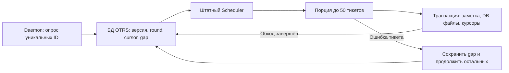

# Проверка синхронизации OTRSRedmineBridge 1.0.31

Дата: 2026-10-12. Сервер и рабочий Redmine не затрагивались.

## Изменения

- Пакетный опрос уникальных связанных issue ID без TicketGet/DF-записей для неизменившихся тикетов.
- Постоянные версии, прогресс и повторы в существующей БД OTRS; Scheduler доставляет ограниченные порции.
- Общие блокировки ручной/фоновой синхронизации и операций связи; короткая транзакция заметки, DB-вложений и курсоров после сетевых операций.
- Статусные журналы разбираются по конкретным ID переходов; обычный HTML не преобразуется для каждого тикета. Ошибка файла запоминается на порцию, HTTP 429/502/503/504 учитывает Retry-After/backoff.

## Среда и методика

Настоящий OTRS 6.0.10 CE, Perl 5.16.3, MariaDB 10.11; Node HTTP peer эмулирует стандартный контракт Redmine и бинарные файлы. Образ OTRS amd64 работает под эмуляцией на Apple Silicon. Три контейнера проекта bridge-perf-local, внутренняя сеть Docker без опубликованных портов. Нет SSH, production-учётных данных или доступа к рабочему Redmine. Znuny 7 отдельно не запускался.

До — точный сохранённый пакет 1.0.30; после — установленный пакет 1.0.31. Для каждого сценария восстанавливается одна и та же синтетическая БД с 1000 тикетов. Рабочее состояние новой схемы прогревается настоящей доставкой, а не искусственными done-строками. Каждый worker использует новый процесс и кеш только в backend; измерение включает ObjectEventsHandle. Время bootstrap и отдельная проверка результатов исключены из CPU; RSS — максимум отдельного процесса. CPU и SQL суммируются на полный проход, RSS берётся как максимум. SQL — SHOW SESSION Questions, включая запросы Store через DBI. Для неизменившихся задач — три повтора, для массовой доставки — отдельные прогоны.

У старой версии 20 порций по 50 запускались подряд для сравнения одинакового полного обхода. В рабочем пятиминутном расписании этот обход занимал около 100 минут. Новый интервал опроса в секундах означает другую частоту работы; показатели одного полного прохода не доказывают снижения средней нагрузки относительно прежней задержки до 100 минут.

## Границы

CPU/SQL настоящего Redmine не измеряются: HTTP peer подтверждает контракт, запросы и передачу байтов. Его ответы не воспроизводят стоимость Rails/БД и большие description/custom fields реального list API. Отдельный постоянно живущий poller добавляет память; пик worker нельзя выдавать за суммарную память сервиса.

Одинаковый updated_on проверяется ограниченными detail-пробами; немедленное обнаружение всех совпавших timestamp не гарантируется. Бюджет worker проверяется между тикетами; один сетевой вызов и последующая обработка событий могут длиться дольше десяти секунд.

DB-транзакция покрывает заметку, DB-вложения и курсоры при InnoDB. Откат FS-хранилища может оставить неиспользуемые файлы. Внешние действия сторонних немедленных слушателей и отправка уведомления после commit не имеют гарантии отката/доставки при аварии процесса. Общий HTTP cooldown через штатный Cache не предоставляет атомарного CAS: узкая гонка между последним сравнением истёкшей записи и её удалением возможна.

## Проверки корректности

Модульный набор: 104 группы, полный PASS (см. unit-final.log). SQLite используется для конкурирующих lease/round/CAS и транзакций; настоящая MariaDB проверяется отдельно интеграционными сценариями. В тестовом адаптере устранена ошибка финализации старого macOS DBD::SQLite: handles явно завершаются до DBI::END; аварийный exit не маскируется.

Проверены: 1000 общих и 1000 различных issue; постоянные обновления источника между порциями и во время загрузки файла; справедливая очередь горячих задач и повторов; независимость тикетов при первой ошибке файла; промежуточный Check→New; обычные комментарии и файлы без заметки; сохранение ручного состояния OTRS при обычном комментарии; более свежая ручная синхронизация; переименование статуса при закешированном каталоге; отдельные лимиты и курсоры; просроченные token/round; rollback после создания article и записи первого DF; 429 и HTTP cooldown без запуска лишних workers; удаление связи и возврат связи; повтор без дублирования.

Состояние OTRS применяется по текущему статусу Redmine. Исторические переходы сохраняются в тексте заметки; повтор после ошибки файла не проигрывает устаревшие open/close в истории OTRS. Ошибка тикета сохраняется как gap, остальные продолжают обход; бизнес-курсор каждого успешного тикета предотвращает дубли заметок при возвращении к gap.

## Поток обработки

`generation` обозначает последнюю обнаруженную версию, `round_generation` — версию начатого обхода. Новое наблюдение не отбрасывает прогресс активного обхода и не прерывает медленную доставку; завершённый старый round не подтверждает новую версию. `served_at` обеспечивает справедливость между issue. `first_failed_ticket_id` не позволяет потерять тикет при обходе ошибки: scan cursor продолжает двигаться, затем возвращается к первому gap с backoff. Тикет имеет собственные бизнес-курсоры journal/attachment, поэтому уже доставленные данные не создают повторную заметку.

Успешная порция обновляет health один раз. Ошибки других issue читаются из надёжного хранилища, поэтому удачная доставка B не скрывает неудавшуюся доставку A. Во время общей HTTP-паузы новые workers не запускаются. При выключенной синхронизации daemon не загружает тяжёлый фасад Redmine/HTTP.

## Итоговые замеры точного пакета

SHA-256 OPM: `81c276b80899edc56668337b38de4d1ae36f4cdc700fb9f722b46f387d682552`. Все 21 исходный файл совпадают с содержимым OPM и установленными файлами. Финальная версия Sync.pm: `82640402d7475e4d27169c1ba93566d47f3cad12a0cd9d7961d344e5ddf22f57`.

| Полный проход | CPU, секунды до → после | Снижение CPU | SQL до → после | HTTP до → после | Пик RSS worker, МиБ до → после |
|---|---:|---:|---:|---:|---:|
| 1000 тикетов, 1 issue, без изменений | 16.957 → 0.087 | 99.5% | 16050 → 13 | 23 → 1 | 78.62 → 67.93 |
| 1000 тикетов, 1000 issue, без изменений | 14.129 → 0.145 | 99.0% | 16050 → 22 | 1003 → 10 | 78.75 → 72.72 |
| 1000 заметок + 1000 файлов по 4 байта, 1 issue | 287.498 → 165.658 | 42.4% | 164068 → 161324 | 63 → 42 | 115.07 → 113.87 |
| 1000 заметок, 1000 issue, без файлов | 199.564 → 151.998 | 23.8% | 146067 → 153138 | 2003 → 1012 | 112.47 → 111.59 |

Для массового сценария с разными issue SQL выросли на 4,8%: долговечная очередь и защита доставки добавляют записи. Снижение CPU и HTTP не означает снижения каждого вида нагрузки. Пиковая память worker при доставке почти не изменилась; постоянный poller учитывается отдельно ниже.

Подробные метрики: [summary.json](20261012-170957-final-package-94bfde4f/summary.json), [raw.json](20261012-170957-final-package-94bfde4f/raw.json). Исходные до-прогоны сохранены в `20261012-152650-benchmark-42f3e1f3` и `20261012-154013-baseline-mass-959e1c8d`; неизменный baseline повторно не запускался.

Финальная интеграционная проверка: [verification.json](20261012-170633-verify-088d0b2c/verification.json), все 10 сценариев PASS. В сценарии ошибки первого файла из 60 связанных тикетов остальные 59 завершили доставку; после восстановления первый тикет получил ровно одну заметку и один файл.

## Крупные файлы

Два чередующихся повтора на десяти связанных тикетах: один файл 4 МиБ скачивается и записывается десять раз в DB-хранилище OTRS (40 МиБ записей). SHA-256 каждой копии, статус, заметки, независимые курсоры и повтор без дублей проверены. CPU медиана 2.129 → 1.963 с; peak RSS worker 108.02 → 108.69 МиБ. Всего два повтора и работа под эмуляцией; небольшой выигрыш не следует считать устойчивой оценкой для production. Существенного изменения памяти в этом сценарии нет. [Метрики](large-file-memory/large-file-summary.json), [проверки и сырые результаты](large-file-memory/large-file-raw.json).

## Штатный Daemon и постоянная память

Настоящий `otrs.Daemon.pl` с модулем расширения и штатным SchedulerTaskWorker обработал 1000 общих связей. Дочерние процессы запускались самим OTRS; одновременно наблюдалось не больше одного обработчика (настройка SyncWorkers=1). Первые заметки обнаружены через 1.44 с после старта, очередь полностью опустела через 481.6 с (8 минут). Все 1000 заметок, состояния и курсоры подтверждены, повтор не создал дублей. Плановое обновление процесса poller каждые 60 секунд не потеряло прогресс. Измерение проводилось с частым /proc/SQL-сэмплированием на ограниченном эмулируемом стенде; это наблюдение, а не production SLA.

Постоянный poller в простое: медиана RSS **66.16 МиБ**, PSS **48.68 МиБ**. Эта память добавляется к сервису. Пик всего ограниченного дерева daemon (supervisor + poller + SchedulerTaskWorker + его потомки): RSS-сумма 269.43 МиБ, PSS-сумма 190.51 МиБ. RSS-сумма повторно считает общие страницы fork; PSS распределяет их между процессами. В простое PSS дерева 105.81 МиБ. Прочие стандартные daemon-модули были выключены только на стенде, поэтому это не полный размер обычной службы OTRS. Прямого замера полного daemon до оптимизации нет: уменьшение общей памяти службы **не доказано**.

[Исходный протокол и сэмплы](20261012-171939-native-daemon-d3a8b61d/native-daemon.json), [проверенный результат и завершение стенда](20261012-171939-native-daemon-d3a8b61d/native-daemon-verified.json). Исходный протокол помечен cleanup incomplete: тест ждал удаления уже завершённого zombie, а PID 1 контейнера — tail. Живых процессов daemon не осталось; отдельно проверены восстановление исходного Config.pm по SHA-256, удаление временной настройки и пересборка конфигурации. Проверка доставки была успешна и не повторялась. Тестовый скрипт исправлен для состояния Z; код расширения не менялся.

## Существующие операции

[Функциональные проверки](functional-legacy-paths.json): создание одной задачи с 16 файлами по 1 МиБ; дополнительные файлы по 512 КиБ из настоящих DB- и FS-кешей формы OTRS; link/relink/unlink без создания issue или загрузки файлов. SHA-256, размеры, токены, имена, MIME, описание, приоритет, исполнитель, срок, проект и трекер проверены. Все четыре сценария PASS. В контрольном прогоне создания с 16 МиБ файлов peak RSS worker 88.99 МиБ, CPU 0.265 с; это одиночный функциональный прогон, не новая статистическая оценка до/после. Прежние спулы, потоковая отправка и лимиты вложений сохранены.

## Установка и итог

Проверены настоящим Package Manager OTRS: обновление 1.0.30 → 1.0.31 с сохранением настроек/ID полей/связей ([протокол](upgrade.json)); чистая установка и переустановка с 13 полями и неизменными ID, обе таблицы и 21 колонка рабочей issue-таблицы ([протокол](fresh-install.json)); прямое обновление 1.0.29 → 1.0.31 с созданием отсутствовавшего attachment-курсора, сохранением старых ID, пользовательского поля формы, настройки SyncBatchLimit=37 и связи ([протокол](upgrade-from-1.0.29.json)).

[Финальная сверка артефакта](final-artifact-check.json): все 21 файла source/OPM/installed совпадают; SHA256SUMS и версия схемы корректны. `git diff --check` пройден. Повторять неизменный модульный набор после изменений только тестовых обвязок и отчёта не потребовалось.

Готовый пакет: `dist/OTRSRedmineBridge-1.0.31.opm`; инструкция: `dist/INSTALL.ru.md`; SHA-256: `81c276b80899edc56668337b38de4d1ae36f4cdc700fb9f722b46f387d682552`. Менялось только расширение OTRS и сопутствующие тесты/документация; Redmine не дорабатывался. На сервер ничего не развёрнуто.

[Очистка стенда](cleanup.json): удалены только три контейнера bridge-perf-local, его том БД и внутренняя сеть. Остальные контейнеры сохранены. Удалены 17 временных файлов: локальные SQL-снимки, .env и раскрытая конфигурация тестового Compose. Исходники baseline, установочные пакеты и обезличенные JSON-результаты сохранены. Для повторного прогона БД и временные учётные данные необходимо создать заново.
